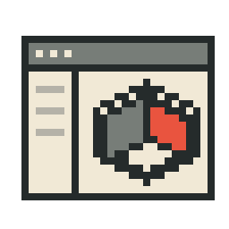

# EPSM Studio

<!-- EPSM introduction: Pocket CAD -->
<picture>
  <source media="(prefers-color-scheme: dark)" srcset="docs/assets/welcome/epsm_studio-dark.png">
  
</picture>

Explore buildings and renovation studies in a visual workspace. EPSM Studio
brings projects, building models, scenarios and results into a web interface.
The current frontend prototype uses demonstration data and browser storage;
authentication, weather and calculations are illustrative, and production
services and scientific execution are planned.

**[Explore the EPSM platform →](https://github.com/SB-Chalmers/epsm/blob/main/docs/platform.md)**
<!-- /EPSM introduction -->

[](https://github.com/SB-Chalmers/epsm_studio/actions/workflows/ci.yml) [](https://github.com/SB-Chalmers/epsm_studio/releases) [](https://github.com/SB-Chalmers/epsm_studio/issues)

## Getting started

Use Node.js 22.12 or newer and npm. Clone the repository to begin:

```sh
git clone https://github.com/SB-Chalmers/epsm_studio.git
cd epsm_studio
cd frontend
npm ci
npm run dev
```

Open the local URL printed by Vite and use the demo login. Projects and drafts are
saved in this browser. Map tiles need internet access; the prototype runs without
a database, server credentials or Python environment.

Run `npm test` and `npm run build` from `frontend/` to check the application.

## Documentation

- [Frontend setup and checks](frontend/README.md)
- [Prototype capabilities and limits](docs/rebuild/frontend-prototype.md)
- [Architecture and delivery plan](docs/rebuild/plan.md)
- [Design manual](docs/design/README.md)
- [Detailed guide and contributing](docs/guide.md)

## License

EPSM-owned source uses the [MIT license](LICENSE.md). Bundled fonts and Viewer
assets retain their own licenses and provenance in the design kit and `frontend/vendor/`.

## People and support

Developed at Chalmers University of Technology as part of the EPSM research platform.

**Funding**: Swedish Energy Agency (Project ID: P2024-04053)

**Partners**:

- Lindholmen Science Park AB
- Sinom AB
- Stiftelsen Chalmers Industriteknik

**Team**:

- **Lead Developer**: Sanjay Somanath
- **Principal Investigator**: Alexander Hollberg
- **Contributors**: Yinan Yu, Dag Wästberg

<p align="center">
  
</p>
