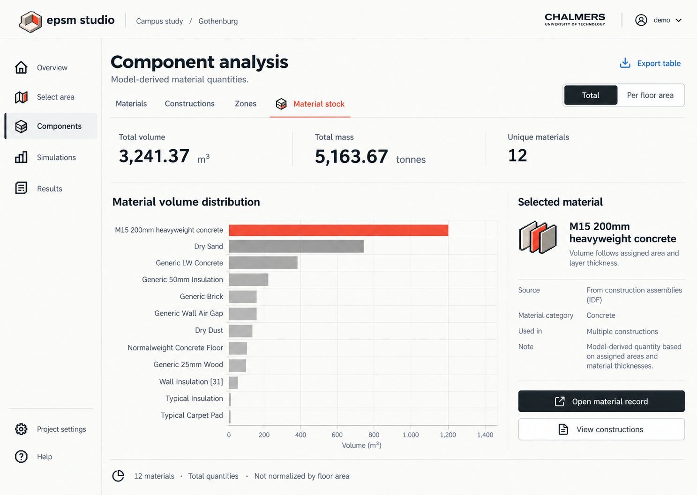
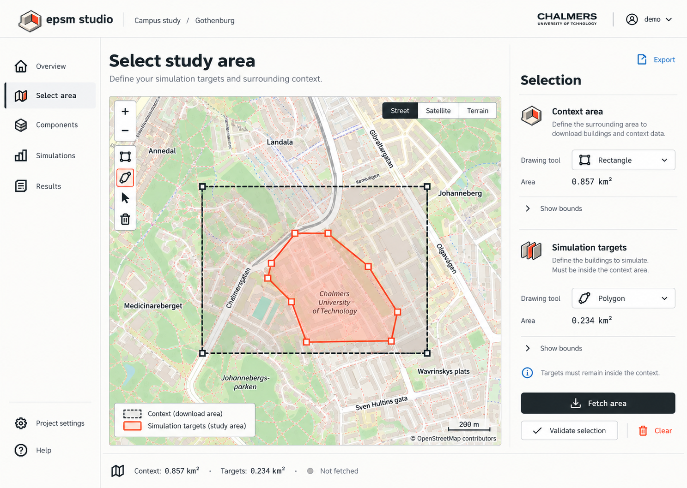
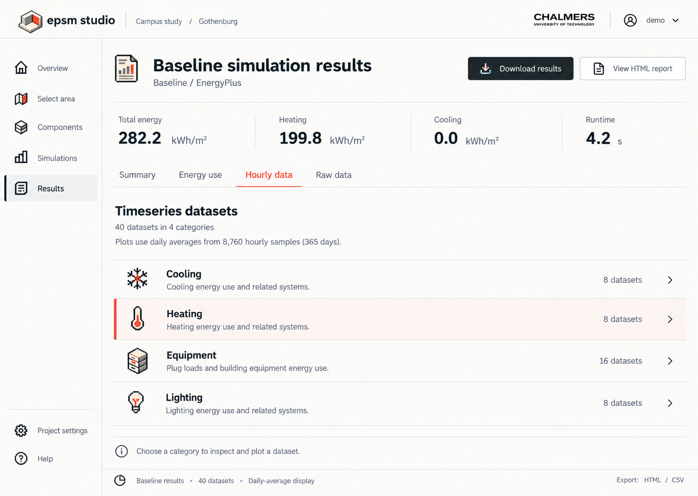

# Pocket CAD · EPSM visual design manual

**Version 1.0.0 · 20 October 2026**

Pocket CAD gives EPSM the character of a small, precise modelling tool: a room made from connected parts, a quiet paper workspace and one active element in vermilion. Pixel artwork supplies the identity; clear modern type and generous spacing keep the science readable.

This manual is the reference for future interface and documentation work. The assets are ready to reuse, but the minimal rebuild scaffold in `frontend/` does not import this theme automatically. `backend/` contains guidance, not a running service; the removed legacy source remains in Git history. The screenshots below are design mockups, not evidence that a feature exists. See the [rebuild status](../rebuild/plan.md) for current capabilities.

## Start here

| Guide | Use it for |
| --- | --- |
| [Foundations](foundations.md) | Identity, colour, typography, spacing and accessibility |
| [Components](components.md) | Buttons, forms, navigation, tables, inspectors and states |
| [Icon system](icons.md) | Repository identities, source grids, exports and accessible use |
| [Data and maps](data-and-maps.md) | Units, evidence, charts, basemaps and area overlays |
| [Adoption](adoption.md) | Copying assets, integration order and review checks |
| [Offline specimen](../../design/pocket-cad/preview.html) | Working HTML examples using the actual fonts and CSS |
| [Asset package](../../design/pocket-cad/README.md) | Tokens, styles, fonts, icons and reproducible commands |

Download the repository and open `design/pocket-cad/preview.html` in a browser for the interactive specimen. It works without a server or network connection; a repository website may display its source instead of running it.

## The visual language

1. **Make the physical model recognisable.** EPSM's small room is the shared motif. Repository identities describe the part each project plays around it.
2. **Use red to point to one active item.** Keep navigation, borders and most controls neutral. A charcoal button carries the main action.
3. **Let the content breathe.** Prefer labelled rows, clear headings and light rules over nested cards. Keep the selected item and its explanation close together.
4. **Keep meanings explicit.** Units, sources, assumptions, run status and missing values are part of the result. Colour never carries them alone.
5. **Borrow the precision, not the clutter.** The retro influence is in the grid and icons. No pixel body text, simulated CRT effects, paper textures, bevels or decorative gradients.

## Three reference screens

These reviewed images establish composition and tone. The tokens and accessibility rules in this manual govern implementation: for example, small selected text uses dark red, even where an image shows brighter red. Blue links and the colourful street map in the concept images are not additional brand colours.

### Select a study area

The map has the largest share of the workspace. A side inspector explains context and target areas without placing long instructions over the map. Dashed and solid boundaries identify roles; red identifies the current selection. See the [map rules and role prerequisites](data-and-maps.md#maps).

### Inspect material stock

The [material-stock image above](images/material-stock.png) uses a single summary row and a horizontal bar chart so long material names remain readable. Only the selected bar is red. The inspector explains that quantities are model-derived and names their basis. A total/per-floor-area control changes the stated units and denominator together.

### Read a simulation result

Keep run identity, engine and summary metrics visible before the detail controls. State whether the displayed data are hourly samples or aggregated daily values. A selected heating row does not imply that heating is the only dataset or that red is its scientific category colour.

## Ownership

Studio owns the Pocket CAD interface assets and this manual. The [EPSM development handbook](https://github.com/SB-Chalmers/epsm_development/blob/main/docs/plotting-and-previews.md) owns scientific plotting conventions. Package renderers implement their own adapters; they must not read a sibling checkout at runtime. The [platform overview](https://github.com/SB-Chalmers/epsm/blob/main/docs/platform.md) explains the repositories and their responsibilities.

Pocket CAD v1 defines a light interface. Dark-background icon variants support README rendering; they do not define a dark application theme.
