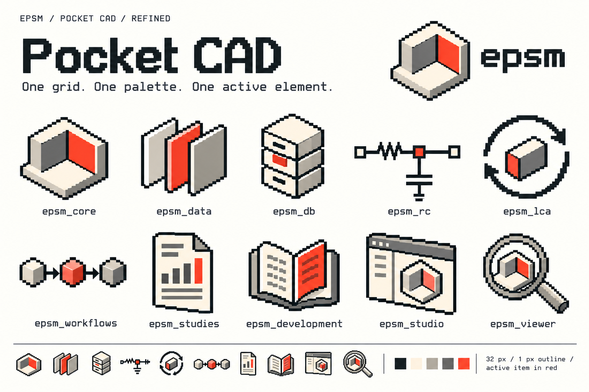

# Foundations

[Manual](README.md) · [Components](components.md) · [Icons](icons.md) · [Data and maps](data-and-maps.md) · [Adoption](adoption.md)

## Identity

The EPSM room mark represents a physical model assembled from connected parts. Related icons show material layers, records, a circuit, an assessment loop, workflow steps, a report, a handbook, a workspace and an inspection lens. A weather file completes the family.



This board records the chosen direction. It is a raster concept, not an export source. Use the [native icon pack](icons.md) for production: its grid, palette and repository names are consistent and machine-checkable.

The influence is the small, purposeful component imagery of CAD tools, including Grasshopper. The EPSM artwork is original; do not copy Grasshopper marks or imply affiliation. Keep institutional marks, such as Chalmers, separate and follow their own usage rules.

## Interface palette

Use the semantic roles in [tokens.json](../../design/pocket-cad/tokens.json), rather than scattering literal colours through an application. The same colour can appear in artwork without inheriting an interface meaning.

| Role | Value | CSS custom property | Use |
| --- | --- | --- | --- |
| Paper | `#FBFBF9` | `--epsm-color-background` | Main page background |
| Surface | `#FFFFFF` | `--epsm-color-surface` | Inputs, menus and raised content only where needed |
| Ink | `#272B2B` | `--epsm-color-text` | Body text, headings, icons and primary actions |
| Muted text | `#616A63` | `--epsm-color-muted` | Secondary descriptions; still readable |
| Divider | `#DFE2DC` | `--epsm-color-divider` | Non-essential grouping rules and table separators |
| Control border | `#858D86` | `--epsm-color-border` | Identifiable fields and interactive boundaries |
| Selection | `#E9543F` | `--epsm-color-selection` | Active marker, selected geometry or a short underline |
| Selection text | `#AE3729` | `--epsm-color-selection-text` | Small selected labels and selection-related links |

The bright selection colour is **not suitable for normal-sized text on paper or white**, or for a button containing small white text. Use ink for main actions and dark selection text for selected labels. Pale dividers do not provide enough contrast to identify a control on their own: inputs and interactive boundaries use the stronger control-border token.

Use these functional colours only with explicit labels and semantic states. They are not extra repository accents or replacements for scientific encodings.

| Role | Value | CSS custom property | Companion cue |
| --- | --- | --- | --- |
| Keyboard focus | `#2459B3` | `--epsm-color-focus` | Visible ring around the focused control |
| Informational state | `#2459B3` | `--epsm-color-info` | Information label and message |
| Passed UI check | `#156443` | `--epsm-color-success` | Name the check and its outcome |
| Warning | `#7A5600` | `--epsm-color-warning` | Warning label and next action |
| Invalid or destructive state | `#A12622` | `--epsm-color-danger` | Error label, marker or specific action wording |

Selection has a separate pale surface token, `--epsm-color-selection-surface`; use it behind a selection marker without reducing text contrast. Focus must remain distinct from selection and validity.

### Keep three palettes separate

| Palette | Meaning | Rule |
| --- | --- | --- |
| Identity artwork | Recognition and material-like shading | Use the five fixed icon colours |
| Interface state | Selected, focused, disabled or invalid controls | Add words, markers or borders; red is selection, not a universal status |
| Scientific encoding | Provenance, quantity, category or result | Follow the handbook and show a legend |

The artwork colours are charcoal `#252B2B`, cream `#F1E9D6`, light gray `#B5B2A8`, gray `#777D78` and vermilion `#E9543F`. Cream belongs inside the artwork, not across the entire interface. The small difference between artwork charcoal and UI ink is intentional.

## Typography

**Inter** is the default for headings, body text, controls, tables and quantities. **IBM Plex Mono** is for source code, file paths, short machine identifiers and coordinate strings. Use ordinary Inter with tabular numerals for comparable values: a table is easier to scan without making every cell look like code.

The asset package bundles **Inter v4.1** and **IBM Plex Mono 2.5.0** with their original OFL 1.1 licences, pinned commits and hashes. Read [font provenance](../../design/pocket-cad/fonts/README.md) before replacing a file. The official upstreams are [Inter](https://rsms.me/inter/) and [IBM Plex](https://github.com/IBM/plex). No font request should be required for the offline specimen.

The bundle includes `InterVariable.woff2`, `InterVariable-Italic.woff2`, `IBMPlexMono-Regular.woff2` and `IBMPlexMono-Medium.woff2`. The font manifest records source versions and hashes. Use `--epsm-font-sans` and `--epsm-font-mono` through the theme instead of adding a remote font import.

| Element | Size / line height | Weight |
| --- | --- | --- |
| Supporting caption | 12 / 18 px | 400 |
| Compact label or table | 14 / 21 px | 400–600 |
| Body and form input | 16 / 24 px | 400 |
| Section title | 20 / 28 px | 600 |
| Panel or metric title | 24 / 32 px | 600 |
| Page title | 28 / 36 px | 600 |
| Large page title or metric | 32 / 40 px | 600 |

Use 12 px only for brief supporting content, never as the only place a unit, error or important result is explained. Body copy should usually fit within 65–75 characters per line. Avoid all-capital paragraphs and letter-spaced control labels. Pixel lettering is reserved for identity artwork.

```css
.epsm-pocket-cad .pc-number {
  font-variant-numeric: tabular-nums lining-nums;
  text-align: right;
}
.epsm-pocket-cad .identifier {
  font-family: var(--epsm-font-mono);
}
```

The UI fallback is `Inter, system-ui, -apple-system, BlinkMacSystemFont, "Segoe UI", sans-serif`. Preserve readable fallback text while a local font loads.

## Space, edges and layout

Use a **4 px spacing unit**, normally 4, 8, 12, 16, 24, 32 or 48 px. Keep 24–32 px between major sections, 16 px within a group, and 8 px between a label and its field. A normal control is at least 40 px high. Give icon-only buttons an explicit accessible name and a 40 × 40 px hit area.

Use 4 px corners for fields, buttons and small panels. Main page sections are usually square and separated with whitespace or a 1 px rule. Reserve shadows for overlays such as menus; avoid shadows around every summary value.

At wide widths, use a compact navigation column, a flexible content region and an optional 280–360 px inspector. At narrow widths, navigation and inspectors flow or collapse with named controls; they must not cover the only route to an action. Keep the main reading order intact. Long tables may scroll inside a labelled region rather than forcing the whole page to scroll horizontally.

## Accessibility is part of the visual system

- Normal text needs at least **4.5:1** contrast; large text and meaningful control or graphic boundaries need at least **3:1** against adjacent colours.
- Keep a visible, contrasting focus ring. It is a keyboard state, not the same as a selected item, and must remain visible when both apply.
- Pair selected states with an underline, leading rule or check mark and the appropriate semantic attribute.
- Keep essential content visible at 200% text enlargement and inspect reflow at 320 CSS px. Do not truncate the only copy of a label or unit.
- Honour reduced-motion preferences. Use a stable loading label and progress count rather than decorative motion.

These rules describe acceptance criteria. A token palette alone does not establish accessibility; review the rendered control, adjacent colours, zoom and interaction states.
