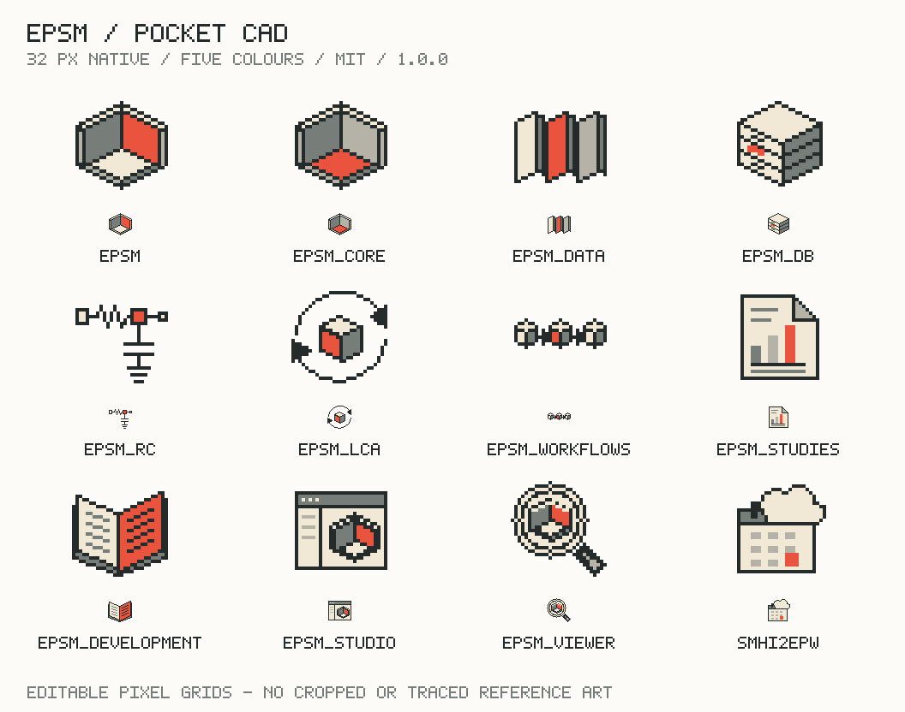
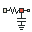
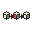

# The icon system

[Manual](README.md) · [Foundations](foundations.md) · [Components](components.md) · [Data and maps](data-and-maps.md) · [Adoption](adoption.md)

One grid, one palette, one active element. Each repository icon describes a responsibility, while the room motif ties the family to physical building models.



Open the [icon catalogue](../../design/pocket-cad/icons/catalogue.html) for individual light and dark previews. These native assets replace the raster concept board as the production source.

## Twelve identities

| Icon | Repository | Meaning |
| --- | --- | --- |
|  | `epsm` | The connected platform: an open room with an active inner wall |
|  | `epsm_core` | The physical model: the same room with an active floor |
|  | `epsm_data` | Construction definitions: three material layers with one active layer |
|  | `epsm_db` | Building evidence: a stack of record drawers with one active record |
|  | `epsm_rc` | Reduced-order energy modelling: a resistor–capacitor circuit |
|  | `epsm_lca` | Climate assessment: a material block inside an assessment loop |
|  | `epsm_workflows` | Orchestration: linked steps with one active step |
|  | `epsm_studies` | Reproducible studies: a report with an active result bar |
|  | `epsm_development` | Shared guidance: an open handbook with an active page |
|  | `epsm_studio` | The application workspace: a room inside a window |
|  | `epsm_viewer` | Visual inspection: a lens around a room |
|  | `smhi2epw` | Weather preparation: a calendar, cloud and one active sample day |

These are identities, not capability badges. An icon in a README does not imply that a repository is released or that a feature has been implemented.

## Construction rules

- Draw on an integer-aligned **32 × 32** source grid. Use a consistent 1 px charcoal contour, deliberate stepped diagonals and quiet cream/gray faces.
- Use only the five [artwork colours](foundations.md#keep-three-palettes-separate), plus transparency. Do not add gradients, blur, texture, drop shadows or per-repository accent colours.
- Give each icon one meaningful red active item. Separate red pixels may belong to that one item, such as a page or chart bar; do not scatter red decorations.
- Reuse the room's perspective and face shading where a room or block appears. Flat symbols, such as the thermal circuit, keep the same contour weight and palette.
- Preserve the metaphor when adding detail. At 32 px, the silhouette should explain the role before its label is read.

The red element inside an identity is permanent artwork. It does not communicate whether that repository, page or control is selected. Interface selection needs its own underline, leading rule, label or semantic state.

## Formats and sizing

| Asset | Location in `design/pocket-cad/icons/` | Use |
| --- | --- | --- |
| Editable native source | `source.json` | Authoring and review on the 32 px grid |
| SVG | `svg/<repository>.svg` | Documentation, web UI and print |
| SVG sprite | `sprite.svg` | Bundled application identities |
| Transparent PNG | `png/<size>/<repository>.png` | 32, 64, 128, 256 and 512 px exports |
| Dark SVG | `svg/dark/<repository>.svg` | A thin light outer keyline on dark README backgrounds |
| Dark PNG | `png/dark/<size>/<repository>.png` | The matching dark-background export |
| Manifest | `manifest.json` | Version, hashes and export inventory |

Display repository identities at 32 or 64 CSS px in interfaces, or at an integer multiple for larger identity placements. Avoid shrinking them to 16 px or fractional scales: the 32 px design contains information that will be lost. Set both width and height to prevent layout shifts. For raster enlargement, use `image-rendering: pixelated`; do not use that setting on text, charts or maps.

Leave at least 4 px around the icon and 8 px before a label. Keep the name readable as text instead of baking it into the icon. Do not stretch, rotate, recolour or crop an export to invent a variant.

## Accessible use

When the visible name already identifies the icon, use `alt=""`. When an icon stands alone as meaningful content, give it a concise name such as `alt="EPSM Studio"`. Name icon-only controls by their action, for example `aria-label="Open building record"`; do not describe every pixel.

For README introductions, use a local light/dark picture and a plain-text title:

```html
<picture>
  <source media="(prefers-color-scheme: dark)"
    srcset="docs/assets/brand/epsm_studio-dark.png">
  
</picture>
```

The thin light keyline keeps the silhouette legible on a dark page. It is an export variant, not a dark application theme or a different repository identity.

## Build, check and distribute

Run from the Studio repository root:

```sh
python3 design/pocket-cad/scripts/build_icons.py
python3 design/pocket-cad/scripts/build_icons.py --check
```

The builder uses the editable source to create the SVGs, PNGs, sprite, catalogue, contact sheets and manifest. The check is read-only and fails if an export or recorded hash differs. Commit the source and regenerated outputs together; do not edit generated SVGs or PNGs by hand.

Each repository keeps its own checked copies in `docs/assets/brand/`, with the originating version and hashes. Copies must work without a sibling Studio checkout or a request to another repository's raw-content URL. When the canonical artwork changes, update those copies and their provenance together.

Original EPSM icon artwork is covered by the pack's [MIT licence](../../design/pocket-cad/icons/LICENSE). Font licences are separate. The concept's CAD influence does not grant rights to third-party marks.
