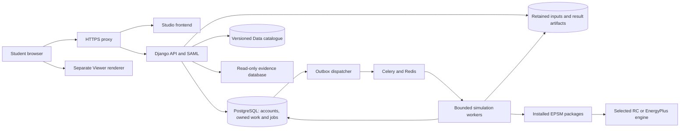

# Proposed Studio architecture

**Status: production target architecture, updated 20 October 2026.** The
[frontend prototype](frontend-prototype.md) implements browser persistence,
authoring, the pinned Viewer and illustrative evaluations. Real authentication,
HTTP adapters, server persistence, workers, scientific package integration and
deployment remain future work. The [delivery plan](plan.md) continues with a minimal
backend/database, SSO and private workspaces before simulation execution. Legacy
data is not migrated. Its application source and deployment files are removed from
this checkout; its remote runtime is retired after replacement cutover. The
pre-cleanup Studio source remains in Git history at `f089d03`.

## Source evidence and its limits

The following local `main` references were inspected for this plan. A source
revision establishes what was available to inspect; it does not establish that all
packages form a tested combination or that a remote service is configured that
way. This initial package inventory was source-only: it did not contact a server,
live database, IdP or engine. Later legacy-server inspection and the user's
successful legacy SSO test do not establish that the new application works.

| Repository | Inspected main revision | Evidence used |
| --- | --- | --- |
| Studio | `9c72a53a6dfb` | Legacy source, authentication, jobs and deployment; current main/dev refs were identical at exploration |
| EPSM | `5c81c88168cf` | [Public interface](../../../epsm/src/epsm/__init__.py), [README](../../../epsm/README.md), evaluation identity and cache source |
| Core | `43c830bf9cd5` | [Public authoring interface](../../../epsm_core/src/epsm_core/__init__.py), [README](../../../epsm_core/README.md), [prepared geometry](../../../epsm_core/docs/geometry-cache.md) |
| Data | `bc8449402b9e` | [Public catalogue and physical definitions](../../../epsm_data/src/epsm_data/__init__.py) |
| Database | `9e29a575f549` | [Public interface](../../../epsm_db/src/epsm_db/__init__.py), [record/stock routes](../../../epsm_db/README.md) |
| Workflows | `a8d29afac1b8` | [Public designs/execution](../../../epsm_workflows/src/epsm_workflows/__init__.py), [reusable workflow contract](../../../epsm_workflows/docs/reusable-workflows.md) |
| Studies | `3eabd42219eb` | [Public protocol/comparison surface](../../../epsm_studies/src/epsm_studies/__init__.py), [README](../../../epsm_studies/README.md) |
| RC | `e11c8e4adf79` | [Shared Building interface and engine limits](../../../epsm_rc/README.md) |
| LCA | `00141d0500e7` | [Package purpose and assessment interface](../../../epsm_lca/README.md) |
| Weather | `e7ca34af0ef0` | [Weather package](../../../smhi2epw/README.md); local main was ahead of cached origin/main |
| Development handbook | `987fdc2c03e6` | [Style](../../../epsm_development/docs/engineering-style.md), [I/O](../../../epsm_development/docs/io-and-api.md), [examples](../../../epsm_development/docs/examples-and-use-cases.md), [plots](../../../epsm_development/docs/plotting-and-previews.md) |

Links into sibling repositories identify source locations in the shared workspace.
Use the recorded revisions to reproduce the review; those working files can change.
Do not import these directories at runtime. Several checkouts had unrelated local
changes, which are not part of this main-only capability inventory.

The separate Viewer and Core scene extraction are an agreed target. Core main at
the revision above still includes older browser/notebook preview methods; the
`epsm.scene/1` scene extraction and related local handbook amendments must pass
their own checks before Studio consumes them. This plan does not claim that those
changes are already a released main capability.

## Keep application adapters in Studio

An application adapter turns a package's supported values and diagnostics into the
forms, HTTP responses, selections and saved application records needed by Studio.
All such web adapters belong here. They must call public package operations and
preserve their meaning, rather than copy scientific calculations or require other
packages to know about browsers, authenticated users or application jobs.

| Owner | Responsibility used by Studio | Current public surface or target |
| --- | --- | --- |
| Studio | Sessions, application roles, projects/drafts, HTTP/forms, authorisation, jobs, quotas, view state and exports requested by its users | Proposed new application; legacy implementation is reference material only |
| EPSM | Evidence-to-physical-model assembly and coordinated energy/LCA evaluation | `Building.from_record`, `Building.simulate`, `EvaluationCache`, `evaluation_identity` and retained evaluations exist; Studio maps UI requests to them |
| Core | Physical Building/geometry, quantities, validation, EnergyPlus compilation/execution and result meaning | `Building`, `Footprint`, `GeometrySpec`, readiness, snapshots and engine tools exist; neutral scene operations are an extraction dependency |
| Data | Sourced catalogue assumptions, shared physical construction definitions, operating profiles and factors | `Catalogue`, construction classes and profile operations exist; Studio saves effective selections and versions |
| Database | Read-only record retrieval, building identity, factual observations, provenance and coverage | `Database`, `Stock`, `BuildingRecord` and portable record operations exist; live access and sufficient height evidence require a separate check |
| Workflows | Reusable designs, frozen cases, execution attempts, resume and analysis | `grid`, `latin_hypercube`, `sensitivity_design`, `analyse_sensitivity`, `parametric_cases`, `prepare`, `run_local`, `read_results` exist |
| Studies | A portable research protocol and study-owned comparison/reporting | `PaperStudy`, `compare_energy_results`, `write_comparison_report` exist; newer uncommitted helper modules are not assumed |
| RC | Reduction of the same physical Building and reduced-order energy results | `RCSettings` and `simulate_building` exist; capability/approximation policies remain explicit |
| LCA | Assessment boundary, factors/quantities interpretation and environmental results | Existing assessment operations; an incomplete assessment does not erase successful energy |
| smhi2epw | Explicit weather acquisition/generation, inspection and provenance | Existing package operations; provider work is a deliberate job, never an incidental page load |
| Viewer | Browser rendering, interaction and optional Python display of neutral scenes | Separate `epsm_viewer` TypeScript package and optional Python display are the agreed target; no Core import or model assembly in the renderer |

Package-owned domain conversions are distinct from web adapters. For example,
EPSM already owns converting a portable record and selected assumptions into its
Building. Studio should call that route and adapt the result for a form; it should
not ask Database to return an HTTP model or move the form adapter into EPSM.
If a required public operation cannot supply enough information, record the gap
with its owner and implement/test that operation there first. Do not guess a new
method name in application code or import a private helper.

## A small deployable shape

The initial implementation direction is a React/Vite frontend, one Django web
application, PostgreSQL state and a Celery/Redis dispatch queue feeding a bounded
worker pool. Introduce the backend before SSO and the queue at the first simulation
milestone. Start with one worker using a tested installed-package environment.
Keep web adapters and release assets in Studio; scientific packages are installed
libraries, not separate network services or deployment repositories.

This is a target diagram, not a description of implemented processes. The frontend
prototype lives at `frontend/`; `backend/` currently contains service guidance only.
Introduce the smallest new Python service there at the backend gate. Long work
always runs outside the web request and is represented by durable PostgreSQL
jobs. The outbox dispatcher publishes accepted work reliably; Redis is transport,
not the source of job status or result evidence. See the
[queue requirements](plan.md#central-simulation-execution)
for delivery, claims, retries, fairness, quotas and recovery gates.

Use shared PostgreSQL application tables with enforced user/project ownership,
not a physical database for each account. Keep a logically separated, versioned
material catalogue consumed through Data, and an explicit private persistent
artifact directory initially. Every file download requires authorisation; result
files are not public static assets. The evidence database is a separate read-only
source: its credentials never reach the browser or a saved model. Do not share source-database
write privileges with application persistence. Storage quotas and retention apply
to their actual owners; [cache eviction](cache-policy.md) is a separate policy.

For future same-server delivery, build/test the application and worker artifacts
once in CI, record their digests and package/engine identities, and deploy those
exact artifacts with a dedicated trusted deployment runner. Release pushes to
`main` can deploy after required checks. Use separate development/staging/production
state and secrets, serialize deployments, run migrations deliberately and switch
routing after readiness checks. Keep runtime secrets and private keys outside Git
and images. Preserve the previous manifest and verify database-plus-file restore
and recovery before each cutover. Drain workers or retain matching runtimes for
accepted jobs during releases. Retire only confirmed legacy resources after the
replacement is accepted; preserve infrastructure and credentials it still needs.
The new CI workflow checks only the frontend and design assets. Server deployment
and production routing are not implemented by this baseline cleanup.

## Data passed through the application

These are proposed persisted concepts, not new package classes or implemented
HTTP endpoints.

| Concept | Required content and behaviour |
| --- | --- |
| Account and external identity | Internal user ID and unique IdP issuer/stable scoped subject; first validated login creates a normal account, later logins reuse it; explicit application roles and fresh sessions |
| Project draft | Owner/access policy, research question, selected targets/context, physical model, choices and provenance; server revision and save history; editable before submission |
| Portable source record | Source IDs, evidence release, component geometry/heights, missing/conflicting values and quality findings; no live connection or credentials |
| Physical baseline | Package-owned Building state with effective catalogue assignments, explicit assumptions, units/CRS/orientation, evidence and readiness |
| Experiment design | Parameter names and physical meaning, units, values/distributions, seed, constraints, exact row order and statistical grouping, target membership and intended response |
| Run snapshot | Immutable draft/design revision, complete engine settings/default profile identity, weather bytes and semantics, assessment settings, package/runtime identities and asset digests |
| Job/case/attempt record | Ownership, submission identity, intended cases, execution state, cancellation/retry decisions, diagnostic locations and selected result; attempts remain distinct |
| Result/report | Metrics with units, area/time basis, coverage and engine meaning; failed/incomplete rows; input and artifact identities; permitted portable export |

The server is the source of truth for saved drafts, submitted plans, permissions
and job status. Browser state is a view or a recovery copy. Package snapshots and
artifacts retain scientific inputs; application metadata links them to a user and
study. Repeated use of a cached calculation still creates a separate run/evaluation
record with its own provenance.

## Engine settings and readiness

Select EnergyPlus or RC explicitly for each submitted study. Show the owning
package's supported default settings/profile, resolve the complete values and save
them in the run snapshot. A later application or package default change affects
only new drafts/runs. Resetting a form to defaults cannot modify a submitted run.

Default settings are a starting modelling choice, not a claim that the two engines
represent every feature identically. Core main describes EnergyPlus 24.2; legacy
Studio invokes EnergyPlus 23.2.0. The replacement must pin its tested executable
and schema rather than reuse an old result or resume identity across those engines.
RC's current shared route requires explicit reduction policies and rejects or
records supported approximations. Some geometry, airflow, ground, calendar and
output requests have engine-specific limits.

Readiness must check the selected physical model, weather/calendar, engine
availability, supported settings/features and requested output/assessment coverage.
Collect package diagnostics without translating an error into an unrequested
fallback. A model can be geometrically inspectable yet not simulation-ready.
Energy success and LCA completeness are separate statuses. Engine comparisons
also require compatible input/metric definitions; running both is insufficient.

## Viewer boundary

The agreed scene format is Core-owned `epsm.scene/1` with polygon geometry.
Scene generation uses the already selected physical model and its inspected
metadata. It does not fetch evidence, choose defaults, triangulate a second physical
model or execute an engine as a side effect. Exact fields and public scene methods
are defined and tested by the extraction work, not invented in this plan.

Viewer receives the neutral scene, renders polygons and provides selection and
display controls. Any triangulation needed for drawing stays a renderer detail;
triangles do not become a second interchange or scientific geometry schema.
Studio maps selection to its forms, chooses what authorised data to load and
shows the model/scene revision. Core owns physical coordinates, orientation,
quantities and validation. The optional Python display package belongs with
Viewer, keeping Core independent of browser and notebook runtime dependencies.

Before integration, use real scenes to check holes/disconnected components,
identifiers, coordinate frame, scale, missing/incomplete cues and resource cleanup.
Scene tests in Core do not replace real renderer checks in Viewer or application
selection/ownership tests in Studio.

## Existing 3JS Web Editor reference

The local repository is named `threejsEditor`; its
[README](../../../threejsEditor/README.md) calls it **3JS Web Editor for SBE
Education** and identifies the HEATH teaching project. Main revision
`4696b08f723680d94635e4d45b4cde8fcd0a2899` was inspected read-only on
20 October 2026. The checkout was clean. This is an additional interaction/editor
reference, not an installed EPSM dependency or implemented part of the rebuild.

Provenance needs to be settled before extracting source: README lines 228–243
identify the project team, while lines 257–259 say the licence is **TBA**. No
tracked LICENSE/COPYING/NOTICE file or `package.json` licence declaration was
found. Preserve the real authorship and resolve the source's licence/ownership and
relevant dependency/asset terms before copying it into an EPSM package. The
README's licence badge is not a substitute for those terms. No source was copied
from this repository during the inspection.

| Existing source evidence | Concrete behaviour | Candidate destination and adaptation |
| --- | --- | --- |
| [CameraManager](../../../threejsEditor/src/core/CameraManager.ts), lines 36–55, 121–135, 183–237, 372–419 | Plan mode, perspective/orthographic navigation, named views, camera transitions and fit to objects | Viewer: generic camera/viewport controls, adapted to Core scene axes, scale and stable identifiers |
| [useBuildingManager](../../../threejsEditor/src/hooks/useBuildingManager.ts), lines 860–919; [useClickHandler](../../../threejsEditor/src/hooks/useClickHandler.ts), lines 39–86 | Ray-based picking, building/footprint selection, hover and drag-versus-click handling with coalesced movement | Viewer: generic selection and hover events; Studio: map selected scene IDs to authorised forms and records |
| [WorkspaceControls](../../../threejsEditor/src/components/model/WorkspaceControls.tsx), lines 75–92; [useWorkspaceEditor](../../../threejsEditor/src/hooks/useWorkspaceEditor.ts), lines 217–260 | Vertex and edge-insertion handles, move handle, rotation ring, snapping and pointer capture | Viewer candidate: optional generic interaction handles; Studio owns edit mode and submitted candidate values; Core validates accepted physical geometry |
| [useWorkspaceEditor](../../../threejsEditor/src/hooks/useWorkspaceEditor.ts), lines 124–156, 167–200 | Polygon/rectangle drawing, reshape, insert/remove points, cancel and undo/redo interactions | Studio editor adapter: reuse the interaction approach around supported Core authoring; do not retain an independent building extrusion/validation implementation |
| [WorkspaceHistory](../../../threejsEditor/src/utils/workspaceHistory.ts), lines 11–37; [useBuildingEditSession](../../../threejsEditor/src/hooks/useBuildingEditSession.ts), lines 85–170 | Detached snapshots, bounded 100-command history, redo clearing, preview/commit/cancel and stale-session discard | Studio: per-draft command/history policy and pending-edit lifecycle, extended to server revisions and recovery; this in-memory history is not durable autosave |
| [BuildingEditPanel](../../../threejsEditor/src/components/BuildingEditPanel.tsx), lines 76–151; [GeometryInspector](../../../threejsEditor/src/components/model/WorkspaceControls.tsx), lines 27–46 | Selection-linked inspector, grouped physical properties, exact numeric entry, inline errors and geometry controls | Studio: form/inspector layout; values, choices, units, missing states, defaults and readiness come from public package operations |
| [exportBuildings](../../../threejsEditor/src/hooks/useBuildingManager.ts), lines 792–844; [ImportConfigDialog](../../../threejsEditor/src/components/dialogs/ImportConfigDialog.tsx), lines 20–44 | JSON export/download and file/drop import feedback | Studio: file-picker/download UI only; use documented EPSM artifacts and validation rather than the editor's version-2.1 BuildingModel format |
| [SceneManager](../../../threejsEditor/src/core/SceneManager.ts), lines 80–110; [FootprintEditorService](../../../threejsEditor/src/services/FootprintEditorService.ts), lines 56–76 | Listener, geometry and material cleanup | Viewer: lifecycle/resource-release patterns, with tests against its actual ownership and shared-resource rules |
| [EPWParser](../../../threejsEditor/src/services/EPWParser.ts), lines 102–139, 194–207, 295–302 | Browser weather-cache limits, clear operation and an expired-cache fallback | Studio reference for cache controls only; use the rebuild's content/calendar/provenance keys and permission scope; expired weather must not silently become a run input |

The transform tools found are custom footprint handles and a rotation-ring UI;
this inspection did not find a general Three.js `TransformControls` integration
or establish general mesh scaling/editing support. The code uses an X/Z ground
plane and a local `BuildingModel`; adapting coordinates and identities is required
before it can consume neutral Core scenes.

Keep scientific rules with their package owners. For example,
[buildingMetrics](../../../threejsEditor/src/utils/buildingMetrics.ts), lines
22–35 and 63–84, computes a simple floor-area/height model and validates one
footprint outline; it must not become the authority for Core geometry, quantities,
holes, disconnected components or thermal readiness. Existing facade/window
generation, energy/daylight clients and hand-entered construction/HVAC defaults
are not automatically compatible with the EPSM model and are not reuse commitments.

The editor also illustrates boundaries that the rebuild must change: its
[DesignExplorationService](../../../threejsEditor/src/services/DesignExplorationService.ts),
lines 15–17, starts afresh each session; the
[save dialog](../../../threejsEditor/src/components/dialogs/SaveConfigurationDialog.tsx),
lines 17–24 and 42–70, couples saving to studies. Studio requires server-backed
draft recovery and separate, deliberate run submission. Existing source tests and
historical UI audit files are useful starting evidence; they have not been rerun
here and do not prove compatibility with the new scene format or packages.

Use this inventory at the package-contract and M9 building-editor gates to choose
a small licensed extraction or an independent implementation of the needed
interactions. Check the resulting Viewer/editor with
actual Core scenes and the student journeys. The scaffold gains no editor feature
merely because a candidate is listed here.

## Identity, failure and evidence boundaries

Use same-origin application routes and protected downloads. Authenticate HTTP and
any progress transport, authorise every project/case/artifact access, and keep
application administrator roles explicit. SAML attribute mapping must preserve
stable scoped identities without using browser-supplied owner IDs as authority.
Keep the registered public SAML identity/callbacks for the first replacement;
coordinate metadata and signing-key changes with Chalmers IT. Do not import legacy
sessions or equate institutional affiliation with administrator access. The
[account and storage contract](plan.md#accounts-ownership-and-storage) defines
fresh provisioning, private workspaces and the required two-user access tests.

One job submission identifies one frozen experiment. Handle repeated requests
without silently creating duplicate work. A worker claims bounded work, records an
attempt, publishes complete verified artifacts and then updates durable state.
Recovery reconciles interrupted attempts before scheduling more work. The transport
cannot be the only record of progress; a websocket disconnect is not a failed run.

Cancellation, idempotent submission and job scheduling are Studio requirements
planned above and still to be implemented and checked. Workflows already provides
prepared-case and attempt/resume semantics, but its existence does not establish
a complete web job lifecycle.
Studio must adapt and test the actual public operations rather than advertise
unimplemented cancellation methods.

Configure logs in the application, using the packages' ordinary logging and safe
context fields. Keep payloads, cookies, credentials and raw private records out of
logs. Each handled failure is reported once with its case/attempt identity and
actionable reason. Returned results and retained artifacts establish outcomes;
logs and a successful UI animation do not establish scientific accuracy.
